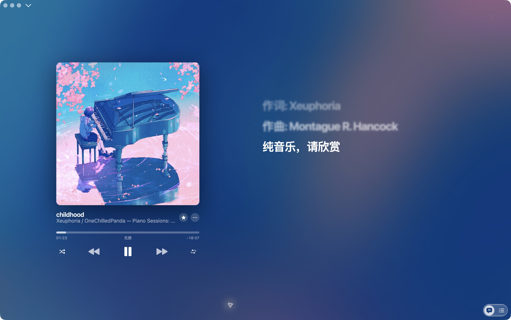
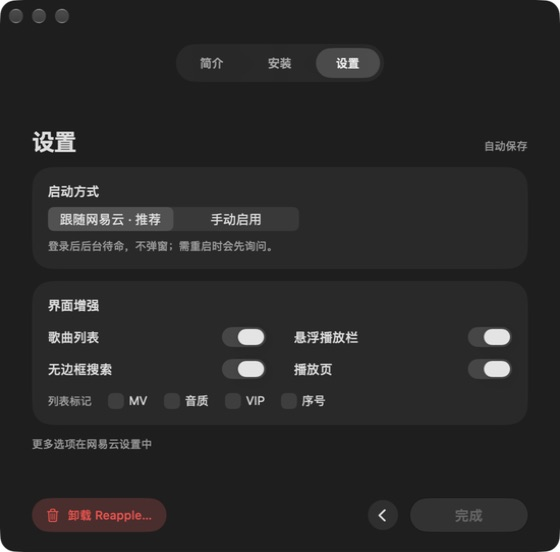

<p align="center"></p>
<h1 align="center">Reapple Music</h1>
<p align="center">熟悉的音乐，更轻盈的界面。</p>
<p align="center">为 macOS 网易云音乐打造的界面增强工具 · 原生菜单栏管理器</p>
<p align="center"><b>Apple Silicon · macOS 14+ · 内测版</b></p>
<p align="center"><a href="https://github.com/Yhazrin/reapple/releases">下载安装包</a> · <a href="#安装">安装说明</a> · <a href="https://github.com/Yhazrin/reapple/issues">反馈问题</a></p>



## 把注意力留给音乐

| 沉浸播放 | 轻量陪伴 | 自己决定 |
| --- | --- | --- |
| 专辑色彩背景、封面动效、聚焦歌词 | 菜单栏常驻管理，不必一直打开设置窗口 | 启动方式、界面元素、音质详情按需调整 |

Reapple 保留网易云的音乐库与播放能力，重新整理播放页面、悬浮栏和视觉层级。它不是独立音乐服务，也不会解锁会员音质或绕过版权限制。

### 少一点干扰，多一点秩序

- **播放页**：专辑封面、歌词与原有播放控制统一排布。
- **悬浮栏**：精简外观，保留收藏与进度交互。
- **音质卡片**：紧凑布局，支持简化显示与查看详情。
- **原生管理器**：引导安装、启动偏好、外观设置与卸载入口集中管理。
- **内置运行环境**：DMG 内含 Node.js，无需另装 Homebrew 或 Node。

<p align="center"></p>

## 安装

1. 从 [Releases](https://github.com/Yhazrin/reapple/releases) 下载 Apple Silicon 内测 DMG。
2. 打开 DMG，将 **Reapple Music** 拖入 **Applications**。
3. 启动 Reapple Music，按引导安装组件；如需重启网易云，请先结束或暂停当前播放。

> **内测提醒**：当前安装包采用临时签名，没有 Developer ID 签名及 Apple 公证。macOS 可能阻止首次打开。只使用本仓库发布的安装包，并核对随包 SHA-256；不建议关闭系统安全保护。遇到阻止提示，可在系统设置的“隐私与安全性”中查看具体原因与系统提供的操作。

### 使用与卸载

安装后从菜单栏打开 Reapple 设置。按使用习惯选择启动方式，不需要始终保留引导窗口。

卸载请使用设置页的 **卸载** 入口，按确认提示移除增强组件，再将 Reapple Music 应用移到废纸篓。仅删除应用不等于移除已安装组件。

## 兼容范围与已知限制

- 本次二进制面向 **Apple Silicon**；Intel、Windows 和 Android 不在此次发布范围。
- 最低部署目标为 macOS 14；不代表已在每个系统版本及每个网易云版本上实测。
- 增强依赖网易云桌面客户端的页面结构与本地调试连接（默认端口 9333），客户端更新可能影响兼容性。不要将调试端口暴露到公网。
- 已进行本机运行及隔离安装/升级/回滚检查；全新机器、重启后的自动启动仍需要更多实际使用反馈。
- 歌词使用宿主提供的数据；当前不承诺逐字卡拉 OK 效果，也不宣称与 Apple Music 或原生 Liquid Glass 完全一致。

反馈时请附 macOS 版本、芯片型号、网易云版本、Reapple 版本与复现步骤；截图请遮挡个人信息。

## 从源码构建

需要 Apple Silicon Mac、支持项目 SwiftUI API 的 Xcode/Command Line Tools，以及 Python 3。最低部署目标不等于构建 SDK 版本。

```bash
git clone https://github.com/Yhazrin/reapple.git
cd reapple
python3 packaging/prepare-runtime.py
bash packaging/build-manager.sh build
```

生成 `build/Reapple Music.app`，使用本地临时签名。运行环境准备脚本从 Node.js 官方站点下载固定版本并验证 SHA-256。发布构建使用 Node.js 22.23.4。

| 目录 | 内容 |
| --- | --- |
| `manager/` | SwiftUI 菜单栏管理器与引导 |
| `payload/` | 网易云页面增强 |
| `agent/`、`bin/` | 注入、连接与命令行管理 |
| `packaging/` | 构建工具 |

## 致谢与许可

由 [Yhazrin](https://github.com/Yhazrin) 与贡献者维护。项目代码采用 [MIT License](LICENSE)；Node.js 使用其随附许可。界面截图中的专辑封面及音乐信息归各自权利人所有，仅用于展示实际界面。

Reapple 是独立项目，与 Apple、Apple Music 或网易云音乐不存在隶属或官方合作关系。
